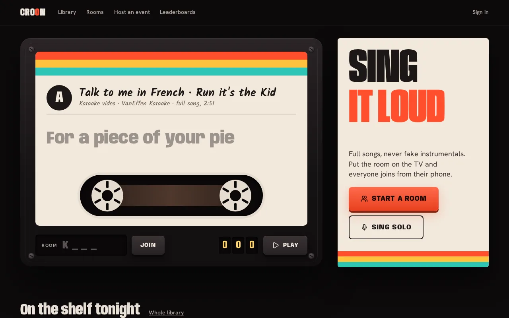

<div align="center">



# Croon

**A karaoke lounge in the browser. Put a room on the TV, everyone joins from their phone, and everybody gets to sing.**

[Open it](https://croon.futile.studio) · [How it works](HOW-IT-WORKS.md) · [Futile Studio](https://futile.studio)

[](https://croon.futile.studio)


</div>

> **Futile Studio · FS-004** · Games, karaoke · Live since Nov 2026

## Overview

One screen (TV, projector or laptop) is the stage. Everyone else scans a QR code or types a four-letter room code on their phone, queues songs, votes, and uses the phone as a remote and as the scoring mic. Guests don't need an account. Accounts add history, favourites and leaderboards.

You can also sing solo and chase a personal best, or run a host night for a venue or office party without singing yourself.

## Features

- **Full songs, honestly labelled.** A house band plays public-domain songs live in the browser, karaoke channels' videos play through YouTube's own player, and you can bring your own file. Nothing pretends an original recording is an instrumental.
- **Lyrics timed to the word** where the data allows (house band, UltraStar, enhanced LRC), line by line where it does not, in five display styles. Lyrics can show in English letters or the original script, and there's an optional English translation.
- **One clock for the room.** The server owns the playback timeline. Every phone and the stage follow it, so late joiners and sleepy phones land on the right line.
- **Fair scoring.** Pitch and timing from the phone's microphone, scored on the server, octave-agnostic and corrected for device delay. Audio never leaves the phone.
- **A fair queue.** One song per person per round, so someone queueing ten songs still waits behind everyone who queued one.
- **Party modes:** duet, battle, group, random challenge, blind karaoke, party roulette, team battle.
- **Find any song.** Look up a song or a whole discography on Deezer, bring it in, and Croon auto-finds synced lyrics (LRCLIB) and a karaoke video (YouTube Data API, when a key is set).
- **Host mode** for organised nights, with a projector stage screen and a leaderboard that outlives the night.

How it works in detail: [HOW-IT-WORKS.md](HOW-IT-WORKS.md). Where the audio and lyrics come from, and why: [docs/SOURCES.md](docs/SOURCES.md).

## Stack

- npm workspace, Node 24+ (runs the server TypeScript directly with type stripping)
- `packages/core`: lyric parsers, house band compiler, shared timeline, queue rules, YIN pitch detection, scoring, modes, realtime protocol schemas
- `apps/server`: Express 5, Socket.IO, Postgres via the `postgres` client with plain SQL migrations, Zod, Helmet, CSRF double-submit
- `apps/web`: Vite, React 19, React Router, Motion, plain CSS

## Running it locally

```bash
docker compose up -d db
cp .env.example .env   # then set CSRF_SECRET to the output of: openssl rand -hex 32
npm install
npm run migrate -w apps/server
npm run dev            # web on :5198, server on :4398
```

`npm test` runs the core tests and the server tests (these need the database). `npm run lint` and `npm run typecheck` check the rest. `npm run build` builds the web app; in production the server serves it from `apps/web/dist`.

To seed a lot of songs without a signed-in user, import whole Deezer discographies from the command line (run from `apps/server`):

```bash
node --env-file=../../.env src/scripts/import-artists.ts <deezer artist id> ...
node --env-file=../../.env src/scripts/import-artists.ts --file artists.json --videos
```

`--videos` also searches karaoke videos, which uses YouTube quota.

## Configuration

All in `.env` (see `.env.example`):

| Variable | What it does |
| --- | --- |
| `DATABASE_URL` | Required. Postgres URL. |
| `CSRF_SECRET` | Required, 32+ characters. |
| `NODE_ENV` | `development` or `production` (default production: secure cookies, no stack traces). |
| `PORT` | Server port, default 4398. |
| `YOUTUBE_API_KEY` | Optional. Lets the song page search YouTube for karaoke videos. Without it you paste a link. |
| `GOOGLE_TRANSLATE_API_KEY`, `DEEPL_API_KEY` | Optional. English lyric translations, cached per song. Google wins if both are set. |
| `TRUST_PROXY` | Number of reverse proxies in front, so rate limits see real visitors. |
| `WARM_LYRICS` | `1` (default) pre-fetches synced lyrics at startup so lyric search works. |
| `SEEDERS` | Comma-separated usernames allowed to seed whole albums and bulk track lists. |
| `LOG_LEVEL` | Pino log level, default `info`. |

## Deploying

Push to `main` runs typecheck, lint and tests, builds the Docker image, pushes it to GHCR and deploys it through Coolify (`.github/workflows/image.yml`, `deploy/`). The container runs migrations on start.

## Licence

No licence file yet, all rights reserved.

---

<p align="center"><sub>Built by <a href="https://github.com/MayurJivani">Mayur Jivani</a> at <a href="https://futile.studio">Futile Studio</a>. Everything is futile. Do it anyway.</sub></p>
